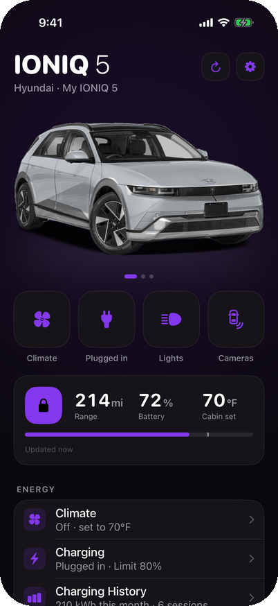
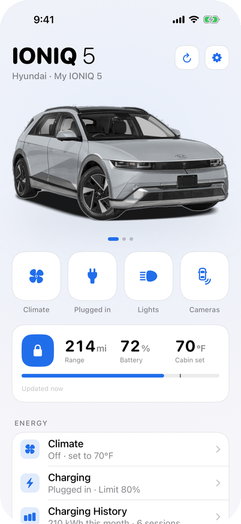
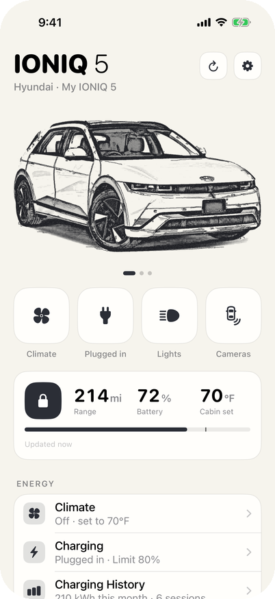
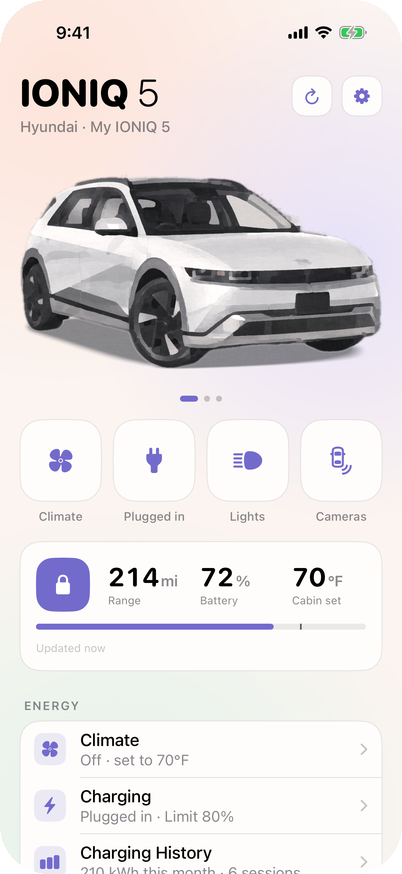
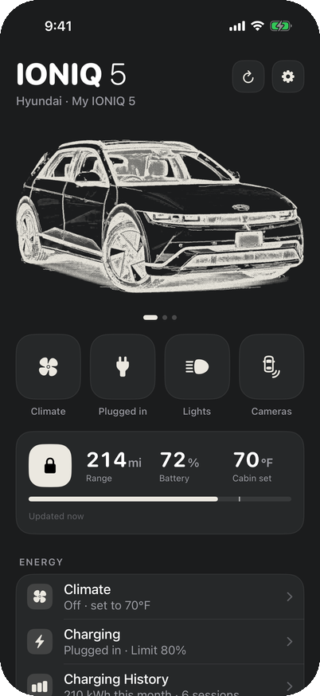
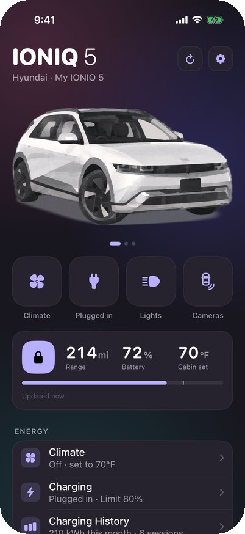
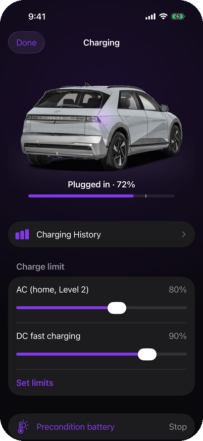
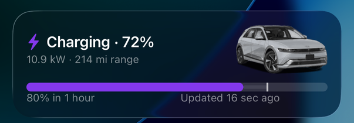
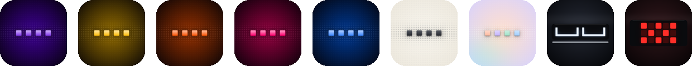

# Ion

A personal, Tesla-style iOS app for the Hyundai IONIQ 5 on Bluelink (US).

<p align="center">
  
  
  
  
</p>
<p align="center">
  
  
  
</p>

<p align="center">
  
</p>

## App icons

<p align="center">
  
</p>

Ion in Blue Violet, Amber Gold, Blaze Orange, Neon Pink and Azure Blue; Sketch; Pastel; and the Headlights and Tail Lights icons drawn from the IONIQ 5's lamps.

## Details

- **API:** [BetterBlueKit](https://github.com/schmidtwmark/BetterBlueKit) (MIT), pinned by commit in `project.yml`.
- **Car artwork:** made from studio photos of the car (front, side and rear) with the scripts in `tools/`: `cutout.swift --full` for the cutout, `recolor.py --studio` for each paint, `sketch.py` for the Sketch theme and `pastel.py` for the Pastel theme. `recolor.py`'s `STUDIO_MASKS` keeps glass, wheels and trim out of the paint. The source photos aren't ours, so the artwork is for personal use.
- **Themes:** Ion (Blue Violet by default, or Amber Gold, Blaze Orange, Neon Pink or Azure Blue), Sketch and Pastel, all following the system light/dark setting. The app icon can match the theme or use the Headlights or Tail Lights icon.
- **Live Activities:** climate warm-up/cool-down and charging sessions.
- **Color detection:** `Shared/AppearanceResolver.swift` scans the Bluelink enrollment response for color fields and calls NHTSA's VIN decoder for make, model, year and trim. If Bluelink reports no color, pick one in Settings. Settings → Diagnostics shows the raw response.
- **Speed:** commands update the UI right away. The app then polls Hyundai's cached status (which never wakes the car) until the car confirms. **Wake** forces a live poll, which is slow and rate-limited.
- **Extras:** Home and Lock Screen widgets, a Control Center lock toggle and climate button, and Siri/Shortcuts ("Lock my car with Ion"). Unlocking requires Face ID.

## Build

```bash
xcodegen generate && open Ion.xcodeproj
```

Signed with the Nathan Coleman individual team (`J3GLV5WWSZ`), using the app group `group.com.nathancoleman.ion`. Sign in with **demo** to try it without an account.
